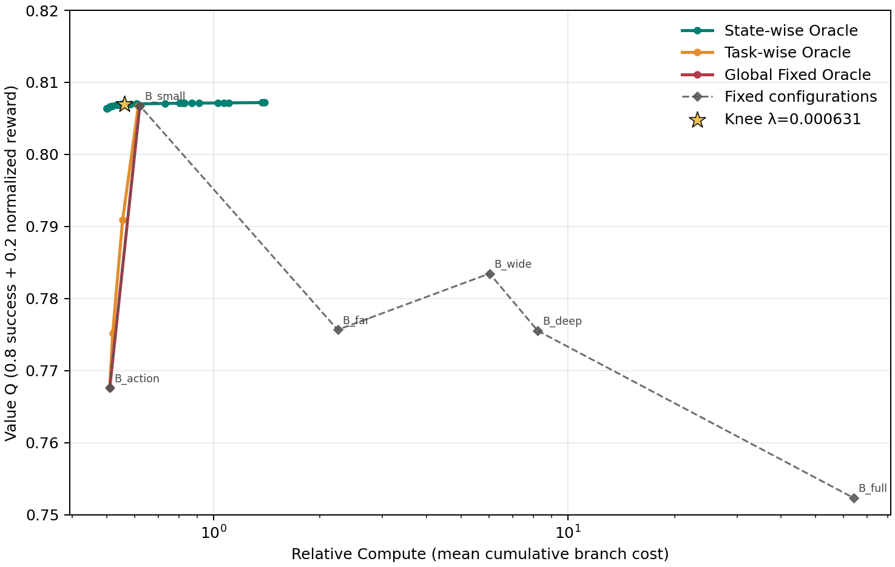
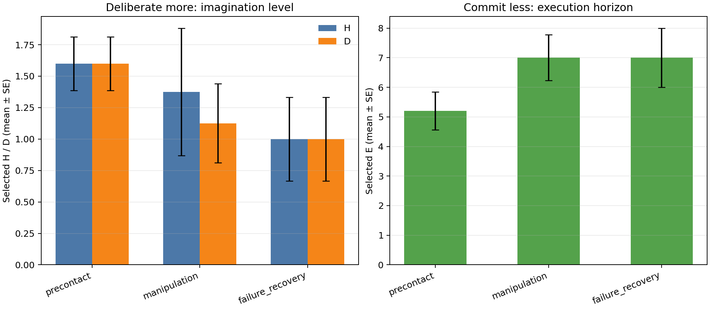
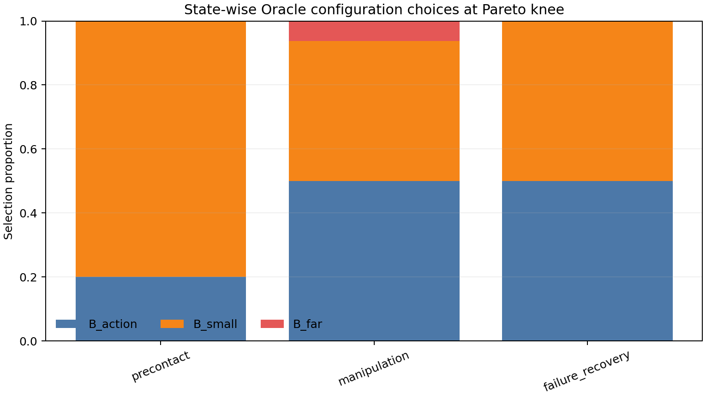

# Adaptive WAM Oracle 自适应计算阶段性实验汇报

## 1. 实验目标

本阶段主要验证以下问题：

1. 高算力配置是否能在低算力配置失败的状态下提高任务成功率；
2. State-wise Oracle 能否根据当前状态动态选择计算配置，在保持性能的同时降低计算成本；
3. 在接触前、物体操作和失败恢复等不同阶段，Oracle 是否呈现“Deliberate more, commit less”，即提高历史窗口/去噪深度并缩短动作执行长度的行为；
4. 后续是否能够进一步将历史窗口 $H$、去噪深度 $D$ 和采样宽度 $W$ 解耦，分析不同不确定性来源对应的计算需求。

---

## 2. Rollout 数据采集

已完成 LIBERO Spatial Task 0–9 的多 Seed 基线采集。

- 主实验：10 个任务 × 5 个 Seed × 2 种配置，共 **100 条完整轨迹**；
- 补充实验：Task 7 的 Seed 5–8，共 **8 条完整轨迹**；
- 当前总量：**108 条完整逐步状态轨迹，共54组配对 Episode**。

两种基线配置如下：

- `No-Imagination`：$(H,D,W,E)=(0,0,1,10)$；
- `Fixed-Full`：$(H,D,W,E)=(8,16,4,2)$。

主实验成功率如下：

| 方法 | 成功数 | 成功率 |
|---|---:|---:|
| No-Imagination | 41/50 | 82% |
| Fixed-Full | 47/50 | 94% |

高算力配置的总体成功率提高了 **12个百分点**。其中差异最明显的任务为：

- Task 1：40% → 80%；
- Task 7：20% → 80%。

最终筛选出 **8组“低配失败、高配成功”的分水岭轨迹**，主要来自 Task 1、5、7、9。这些轨迹被用于后续状态快照提取和反事实推演。

---

## 3. 第一轮 Sustained 反事实评测

从分水岭轨迹中提取了41个状态快照：

| 阶段 | 快照数 |
|---|---:|
| precontact | 15 |
| manipulation | 16 |
| failure recovery | 10 |
| 合计 | 41 |

每个快照测试6种计算配置，每种配置重复3次，因此总计完成：

$$
41\times6\times3=738
$$

条反事实评测记录。

这表明从轨迹恢复仿真状态、切换计算配置并继续执行 Sustained rollout 的完整流水线已经成功跑通。

---

## 4. 修正 $\lambda$ 后的 Pareto 结果

原分析使用的默认值 $\lambda=1.4678$ 对计算成本惩罚过强，导致 Oracle 几乎全部选择最低算力配置，Pareto 曲线接近退化。

当前已经完成以下修正：

- 在 $10^{-4}$ 到 $1.0$ 范围内扫描 **85个 $\lambda$ 值**；
- 使用归一化 Pareto 前沿最大弦距方法选择 Knee Point；
- 将低 $\lambda$ 区间的点和固定配置端点全部加入 Pareto 图；
- 将主分析参数更新为：

$$
\lambda^*=0.00063096
$$

Knee Point 下的结果为：

| 策略 | 成功率 | 综合价值 $Q$ | 相对计算量 |
|---|---:|---:|---:|
| State-wise Oracle | 82.93% | 0.80699 | 0.5611 |
| 最优 Global Fixed（B_small） | 82.93% | 0.80676 | 0.6203 |

在选定的 Knee Point 上，State-wise Oracle 在保持相同成功率的情况下，相比该点对应的最优固定策略节省约：

$$
1-\frac{0.5611}{0.6203}\approx9.5\%
$$

因此，当前数据已经初步证明：**状态级计算配置选择可以在基本不损失性能的情况下减少计算量**。不过，目前的优势仍然有限，还不足以支撑非常强的 Pareto 性能声明。

进一步将 RQ1 的比较标准由无法达到的“100%成功率”修正为双方共同可达到的最高成功率82.93%后，达到该目标所需的最小计算量为：

| 策略 | 目标成功率 | 最小相对计算量 |
|---|---:|---:|
| State-wise Oracle | 82.93% | 0.5014 |
| Global Fixed | 82.93% | 0.6203 |

据此计算的 State-wise 最小算力节省为 **19.17%**。在 B_full 的0.8%–0.9%低算力预算区间内，State-wise 相比 Global Fixed 的成功率领先约4.1个百分点，综合价值 $Q$ 领先约0.039。9.5%描述的是选定 Knee Point 相对固定策略的节省，而19.17%描述的是达到同一目标成功率时的最小算力节省，两者口径不同。

---

## 5. RQ2 阶段机制结果

Knee Point 下，各阶段的平均配置选择如下：

| 阶段 | 样本数 | $H$ | $D$ | $E$ |
|---|---:|---:|---:|---:|
| precontact | 15 | 1.60 | 1.60 | 5.20 |
| manipulation | 16 | 1.38 | 1.13 | 7.00 |
| failure recovery | 10 | 1.00 | 1.00 | 7.00 |

其中，最明确的现象出现在 `precontact` 阶段：

- 80%的状态选择 `B_small`，即 $(H,D,W,E)=(2,2,1,4)$；
- 20%的状态选择 `B_action`，即 $(H,D,W,E)=(0,0,1,10)$。

相较于最低算力配置，precontact 阶段表现出：

$$
H,D\uparrow,\qquad E\downarrow
$$

即初步符合 **“Deliberate more, commit less”** 的机制假设：接触前增加推理投入，同时减少单次动作承诺长度。

### 当前证据的限制

目前还不能宣称完整验证了该机制，主要原因如下：

1. 现有 `manipulation` 快照过于简单，6种配置在这些状态上均达到100%成功率，因此区分度不足；
2. 当前第一轮数据没有 `reaching` 快照，无法完成 reaching 与接触阶段之间的 Mann–Whitney 显著性检验；
3. 当前 Oracle 选择中的 $W$ 始终为1，尚无证据支持 Width 自适应；
4. `failure_recovery` 状态整体成功率较低，部分状态可能已经不可逆，增加推理算力也无法恢复。

因此，目前更准确的表述是：**precontact 阶段已经出现符合核心假设的趋势，但仍需补充 reaching 基线和高风险 manipulation 状态进行统计验证。**

---

## 6. 固定配置实验中的重要现象

六种固定配置的成功率并没有随计算量单调提高：

| 配置 | 成功率 | 平均相对计算量 |
|---|---:|---:|
| B_action | 78.86% | 0.510 |
| B_small | **82.93%** | 0.620 |
| B_full | 77.24% | 64.057 |

当前数据中，`B_small` 反而优于 `B_full`。这说明：

- 盲目增加想象深度和宽度未必持续提高性能；
- 高计算配置可能引入模型误差积累或过度规划；
- 始终使用最大配置不是理想方案；
- 这一现象进一步支持根据状态动态分配计算资源的研究动机。

不过，上述结果来自小规模且经过筛选的分水岭快照，需要通过新一轮困难快照实验进一步确认。

---

## 7. 已准备的补充实验

为解决现有数据的统计和机制缺口，目前已经完成以下数据及代码准备。

### 7.1 Reaching 基线快照

已提取 **12个 reaching 快照**，用于表示低风险自由空间运动。

预期该阶段主要选择：

$$
(H,D,W,E)=(0,0,1,10)
$$

即低想象成本和较长执行长度。该组将作为接触阶段的 Baseline，以完成 Mann–Whitney 方向性检验。

### 7.2 高风险 Manipulation 快照

已重新筛选 **16个高风险 manipulation 快照**，覆盖：

- 夹爪刚接触物体的瞬间；
- 接触丢失或接触不稳定状态；
- 目标距离回退；
- No-Imagination 失败轨迹中的高风险状态；
- Fixed-Full 成功轨迹中的接触边界状态。

这组实验用于打破旧 manipulation 快照“六种配置全部成功”的天花板现象。

### 7.3 $H/D/W$ 解耦实验

已建立包含 **20个核心困难快照、10种计算配置** 的解耦实验网格，分别单独调整：

- 历史窗口 $H$；
- 去噪深度 $D$；
- 采样宽度 $W$；
- 以及 Joint-Full 联合配置。

该实验将用于检验以下假设：

- Temporal uncertainty $\rightarrow H\uparrow$；
- Precision requirement $\rightarrow D\uparrow$；
- Multimodality $\rightarrow W\uparrow$；
- Single-axis 调整与 Joint 配置之间的差异。

---

## 8. 当前执行状态

补充实验已经完成快照、配置和执行脚本准备，但 GPU 计算尚未开始：

- 新增标准评测：28个快照 × 6种配置 × 3次重复，共 **504条结果**；
- 解耦实验：20个快照 × 10种配置 × 1次重复，共 **200条结果**。

补充实验现已使用 GPU 0、4、5、6 正式启动，运行于后台会话 `rq2_followup_4gpu_0456_20261025`。模型四个组件已全部完成显存分配，当前正在执行 reaching 与高风险 manipulation 的504条 Sustained 评测。该阶段结束后，流水线会自动：

1. 将原41个快照与新增28个快照完整合并为69个快照、1242条反事实记录；
2. 重新计算低预算 RQ1、Pareto 曲线、阶段分布和 Mann–Whitney 检验；
3. 继续运行20个困难快照 × 10种配置的200条 $H/D/W$ 解耦实验；
4. 输出单轴响应图和解耦统计报告。

双卡共置方案已做真实模型加载测试，但单卡峰值达到9.47 GiB后仍需额外分配1.96 GiB，在11 GiB RTX 2080 Ti上发生 OOM，因此正式实验必须使用四张独立物理卡。

---

## 9. 阶段性结论

当前实验已经取得以下结果：

1. 完成了 Task 0–9、多 Seed、两种算力配置的完整逐步轨迹采集；
2. 高算力基线成功率由82%提高至94%，说明计算资源在部分困难任务上确实有效；
3. 成功打通了状态恢复、配置切换、Sustained rollout 和 Oracle 分析的端到端流水线；
4. State-wise Oracle 在保持82.93%成功率时，选定 Knee Point 相比固定策略节省约9.5%，按达到相同目标成功率的最小算力计算可节省19.17%；
5. precontact 阶段已经表现出提高 $H/D$、缩短 $E$ 的趋势，初步支持“Deliberate more, commit less”；
6. 最大算力配置并不总是最优，进一步说明状态自适应分配比固定最大算力更合理。

当前仍需等待补充实验完成，以获得：

- reaching 与接触阶段之间的显著性检验；
- 高风险 manipulation 状态下更明确的配置差异；
- $H/D/W$ 单轴解耦响应；
- 更完整的 RQ2/RQ3 结论。

### 推荐的汇报口径

> 当前实验已经验证了完整状态轨迹采集和 Sustained 反事实评测流水线。初步结果显示，状态级 Oracle 能在维持82.93%成功率的同时，按达到同一目标成功率所需的最小算力计算，相比 Global Fixed 节省19.17%，并在 precontact 阶段表现出提高 $H/D$、缩短 $E$ 的趋势。reaching 对照、高风险 manipulation 和 $W$ 解耦补充实验已经启动；在其显著性结果产出前，现阶段应表述为“机制趋势得到初步支持”，而不是“已经达到统计显著”。

---

## 10. 结果文件

- Pareto 曲线：`results/oracle_watershed_v1/oracle_pareto_curve.png`
- 阶段分布图：`results/oracle_watershed_v1/rq2_phase_distribution.png`
- 配置选择比例图：`results/oracle_watershed_v1/rq2_config_selection_stacked.png`
- 完整分析报告：`results/oracle_watershed_v1/oracle_analysis.json`
- 原始反事实结果：`results/oracle_watershed_smoke.csv`

